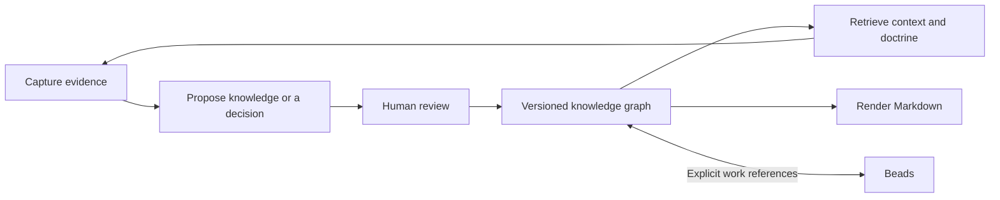

# Scrolls

**Versioned knowledge graphs for humans and agents, backed by [Dolt](https://github.com/dolthub/dolt).**

Scrolls keeps evidence, decisions, questions, and working rules connected across
sessions. Capture a finding, link the understanding it supports, review the
change, and retrieve the context for the next task—with attribution and history.
Markdown bodies stay readable; typed records and relationships make them queryable.

Scrolls is the knowledge companion to [Beads](https://github.com/steveyegge/beads).
Use Beads to track work and Scrolls to record what you know, why you believe it,
and which rules apply. The two keep separate databases and connect through
explicit references.

**Qualified platform:** Linux x86_64 · **CLI:** Rust · **Storage:** private Dolt 2.2.0

[Quick start](#quick-start) · [Commands](#essential-commands) ·
[Agent setup](#agent-setup) · [Beads integration](#beads-integration) ·
[Documentation](#documentation)



## Quick start

Build from source with **Rust 1.85+** and Git. The Dolt installer also uses
`curl`, `tar`, and `sha256sum`; the workflow below uses `jq` to read returned IDs.
Commands with shell variables use **fish**.

```fish
git clone https://github.com/mooselabs/scrolls.git
cd scrolls
./scripts/install-dolt.sh
cargo install --locked --path .
set -gx SCROLLS_ACTOR your-name
scrolls init
```

Ensure Cargo's install directory (normally `~/.cargo/bin`) is on your `PATH`.
The installer checks the pinned Dolt archive's SHA-256 and installs it at
`.tools/dolt`, leaving shared Dolt installations alone. Run these examples from
the checkout; [installation and paths](#installation-and-paths) explains using
Scrolls elsewhere.

Capture evidence, then propose a conclusion supported by it:

```fish
set evidence (scrolls --json --op-id evidence-demo new evidence \
    --title 'Rollback readback' \
    --body 'The interrupted transaction left no rows.' | jq -r .data.id)

printf '%s\n' '[{"op":"new","handle":"conclusion","kind":"knowledge","title":"Atomic local writes","body":"Writes and receipts commit together."},{"op":"link","from":"'$evidence'","rel":"supports","to":"$conclusion","expect":1},{"op":"status","id":"$conclusion","state":"current"}]' > conclusion.json
set proposal (scrolls --json --op-id knowledge-demo batch conclusion.json)
set record (echo $proposal | jq -r .data.handles.conclusion)
set branch (echo $proposal | jq -r .data.branch)

set review (scrolls --json review $branch)
echo $review | jq .data
set review_token (echo $review | jq -r .data.review_token)
```

After inspecting the proposal, a human accepts it:

```fish
scrolls --role human review accept $branch --review-token $review_token
scrolls show $record
scrolls history $record
scrolls render --out ./knowledge-export
```

Acceptance is bound to the proposal and main revisions in the inspected output.
Any change to either, including an unrelated main write, requires another review.
Tokens check revisions within the cooperative role model; they do not authenticate
a person or prove that someone read the output.

The export destination must be new. Review acceptance merges the proposal; the
`status` operation in the batch above is what makes the knowledge `current`.
The demo operation IDs identify these exact writes: reuse them for retries,
and choose new IDs for new work.

Initialize a custom ontology with `scrolls init --schema examples/research.yaml`.
Use `schema show`, `schema validate FILE`, and reviewed `schema apply FILE --expect REV`
to inspect and evolve it. See the [migration guide](docs/migration-0.2.md).

## Features

- **Typed knowledge:** a configurable ontology with explicit lifecycles, owners,
  confidence, review cadence, and attributed relationships.
- **Local history:** Dolt commits retain changes to records and edges. Stable
  `sc-…` IDs survive edits and exports; imported IDs remain lookup aliases.
- **Reviewable changes:** protected records use proposal branches with readable
  body, metadata, and graph diffs before human acceptance.
- **Agent context:** deterministic search and graph traversal, versioned JSON
  output, and a session audit of consumed records and revisions.
- **Rules in context:** `prime` delivers the schema guide, instructions and explicit startup pins,
  reporting when these exceed the context budget.
- **Reliable authoring:** expected revisions reject stale writes, and operation
  receipts make retries with identical inputs safe.
- **Markdown interchange:** import committed documentation at a pinned Git
  revision; export all native kinds, relationships, and an ID-to-path manifest.
- **Beads connections:** find knowledge attached to a bead, explicitly refresh
  cached work details, and publish backlinks into Beads metadata.

## Essential commands

`ID`, `REV`, `BRANCH`, and `PATH` below are placeholders. Use `show` to obtain a
record's numeric revision and write results to obtain proposal branch names.

| Command | Purpose |
| --- | --- |
| `scrolls new evidence --title 'Finding' --body 'Observed result'` | Capture an attributed source. |
| `scrolls list --kind decision --status accepted` | List accepted decisions. |
| `scrolls show ID` | Read a record, its revision, and relationships. |
| `scrolls search 'rollback'` | Search titles and bodies; notes are excluded. |
| `scrolls walk ID --depth 2` | Explore incoming and outgoing graph edges. |
| `scrolls context ID --budget 16000` | Retrieve context around a record or entity. |
| `scrolls prime` | Load the schema guide and configured startup pins. |
| `scrolls edit ID --expect REV --body-file PATH` | Edit against the revision you read. |
| `scrolls new question --title 'Which retention policy?'` | Open an owned question. |
| `scrolls query --file examples/queries/inbox.yaml` | List your open local questions. |
| `scrolls proposals` / `scrolls review BRANCH` | Find proposals and inspect their changes. |
| `scrolls --role human review accept BRANCH --review-token TOKEN` | Accept a reviewed proposal. |
| `scrolls history ID` | Inspect historical record snapshots. |
| `scrolls lint` / `scrolls doctor` | Check review dates, graph integrity, and store health. |
| `scrolls render --out NEW_DIR` | Export a fresh Markdown tree and graph. |

Bodies accept `--body`, `--body-file PATH`, `--body-file -`, or piped stdin.
`edit` opens `$VISUAL` / `$EDITOR` on a terminal; `--editor` selects that behavior
explicitly. See the [full command reference](docs/commands.md) for flags,
relationships, question answers, dry runs, and JSON response contracts.

## Agent setup

Add guidance like this to the instructions your agent reads, after configuring
the store and Dolt paths for your workspace:

```markdown
This project uses Scrolls for versioned knowledge.

- Set SCROLLS_ACTOR to your agent identity before writing.
- Start with `scrolls prime` for the configured guide and startup pins.
- Use `scrolls context <id>` and `scrolls show <id>` to inspect relevant knowledge.
- Capture observations as evidence and link conclusions to their supporting evidence.
- Use `--json` for automation, `--expect` for revisions, and stable `--op-id` values for retries.
- Inspect completed proposals with `scrolls review <branch>` and leave acceptance to a human.
- Preserve the returned review token. Acceptance requires that exact token; any
  change to main or the proposal requires a fresh human review. Never automatically
  refresh a stale token and retry acceptance.
- Keep task status and execution dependencies in the project's work tracker.
```

`init` creates the store; agent instructions are configured manually. Every write
requires an actor, through `SCROLLS_ACTOR` or `--actor`. The default role is
`agent`. Roles provide cooperative local policy and attribution, not authenticated
identities; filesystem access can bypass them.

`context` has a hard byte budget. `prime` delivers configured instructions and pins and reports any overrun.
`context` includes one document and its immediate references. No model is called.
Use `--session NAME` and `consumed --for-session NAME` to inspect the read audit.

## Knowledge and review workflow

| Kind | Use | Write policy |
| --- | --- | --- |
| `evidence` | Captures, observations, and source material | Direct |
| `knowledge`, `primer` | Supported understanding and introductions | Proposal |
| `decision` | Durable choices and their rationale | Proposal |
| `doctrine` | Rules with path or scope triggers | Proposal |
| `entity` | Repositories, services, teams, or other graph anchors | Proposal |
| `question` | An owned open question | Direct |
| `answer` | A response to a local question | Human direct; agent proposal |
| `collection`, `note` | Curated views and session notes | Direct |

Protected kinds use proposals for both human and agent authors. Reads use main
unless you explicitly select `--proposal BRANCH`. Human review accepts or rejects
the branch, while lifecycle changes such as `draft` → `current` and
`proposed` → `accepted` are separate operations. Rejected proposals retain their
history. Accepting an answer also requires the human question owner.

Relationships capture support, derivation, replacement, contradiction, and subject
matter. `about`, `asks_about`, and `related` assertions belong to their source;
referencing a protected target does not edit it. Other internal graph mutations
can require both endpoint revisions. See [relationship rules](docs/commands.md).

## Beads integration

The adapter is qualified against **Beads 1.3.0**. It keeps work references in
Scrolls and requires explicit commands to contact Beads. Existing older stores
need `scrolls migrate` after pending proposals are accepted or rejected; new
stores use format 4.

Bind an existing Beads workspace and link the knowledge record from the quick
start. Replace `bd-example` with a full issue ID from that workspace:

```fish
scrolls beads bind work --directory /path/to/beads-workspace --bd /path/to/bd
set revision (scrolls --json show $record | jq -r .data.record.revision)
set link (scrolls --json link $record implemented_by work:bd-example --expect $revision)
set link_branch (echo $link | jq -r .data.branch)
set link_review (scrolls --json review $link_branch)
echo $link_review | jq .data
set link_token (echo $link_review | jq -r .data.review_token)
# A human accepts after reviewing the change.
scrolls --role human review accept $link_branch --review-token $link_token

scrolls beads refs work:bd-example
scrolls context --bead work:bd-example
scrolls beads refresh --all
scrolls --dry-run beads publish --all
scrolls beads publish --all
```

References are many-to-many and persist as `beads://PROJECT-UUID/FULL-ISSUE-ID`;
the `work:` alias and machine paths stay local. Reads remain offline. `refresh`
caches observed titles and statuses; `publish` reconciles main's backlinks into
this Scrolls store's Beads metadata key, preserving unrelated metadata.
Publication does not change issue status, assignees, dependencies, or scheduler
gates. `implemented_by` records intent, and question `blocks` links are
informational. See the [Beads command contract](docs/commands.md#beads-references).

## Installation and paths

The supported installation path is the source build in the quick start. Python 3
is needed for demonstrations and qualification scripts, not ordinary CLI use.
The private Dolt installer currently supports Linux x86_64 only.

`--store` defaults to `.scrolls` and `--dolt` to `.tools/dolt`, both relative to
the current directory. To use a different workspace, pass absolute paths on
each command:

```fish
scrolls --dolt /path/to/scrolls/.tools/dolt --store /path/to/project/.scrolls init
scrolls --dolt /path/to/scrolls/.tools/dolt --store /path/to/project/.scrolls prime
```

After installation, ordinary authoring and reads need no Git repository, daemon,
remote, or model service. Importing Markdown requires a Git source repository.

## Storage and history

The database lives at `.scrolls/dolt`. Scrolls invokes its pinned Dolt CLI with a
private configuration and serializes store access with a filesystem lock.
Authoring changes and operation receipts commit in one explicit transaction.
Records and edges are keyed JSON rows; those row payloads are the merge units.

The consumption audit and Beads bindings/cache are separate local state. An
unexplained dirty database stops commands for inspection; Scrolls does not
silently discard it. Start with `scrolls doctor` and the
[storage and recovery contract](docs/commands.md#storage-and-recovery).

This release provides local operation and proposal review. Remote synchronization,
server storage, authenticated access, embeddings, executable doctrine checks,
and web/MCP interfaces remain outside the implemented scope.

## Import profiles

Import a pinned Git collection with a bundled or custom YAML profile:

```fish
scrolls import profiles list
scrolls import profiles show pep
scrolls import plan git /path/to/peps --root peps --rev COMMIT \
    --source python.peps --profile pep --out peps.plan.json
scrolls import apply peps.plan.json --op-id peps-initial --dry-run
scrolls import apply peps.plan.json --op-id peps-initial
scrolls show PEP-0008 --provenance
scrolls render --out ./peps-export
```

Planning requires an initialized format-4 store and actor. It reads committed
Git objects and leaves the store unchanged. Apply verifies the plan against the
same store, actor, main revision and schema; protected imports become one proposal.
Use `--profile-file FILE` for your own mapping. The canonical bundled profiles are
[PEP](profiles/pep.yaml) and [handbook](profiles/handbook.yaml).

Captured records and declared source relationships remain source-owned. Local
notes and relationships can cite them. Native export preserves original bytes
and executable modes under `sources/SOURCE_ID/`, alongside normalized views and
provenance. RST is shown as literal source. Multiple independent sources are
supported; changed-source refresh, deletions and section retrieval are deferred.
See the [profile contract](docs/import-profiles.md) and [migration guide](docs/migration-0.3.md).

## Markdown import and export

For a Liskov import, start with an empty store and pin the source commit:

```fish
set source /path/to/liskov-agent-orchestrator
set revision (git -C $source rev-parse HEAD)
scrolls --json import markdown "$source/docs" --rev $revision
scrolls doctor
scrolls show ADR-0236
scrolls query --file examples/queries/applicable.yaml --path repos/liskov-rs/src/example.sql
scrolls render --format liskov --out ./liskov-docs-export
```

Import reads committed Git objects, preserving original metadata, paths, and
assets. Repeating the same source commit is safe; importing a changed source
requires a new store. Unchanged imported files render byte-for-byte. Imported
backlog, epic, milestone, question, and untyped archive records remain immutable.

Both native and Liskov exports include every native kind, `scrolls/graph.json`,
and `SCROLLS-MANIFEST.json`. Native decisions use stable `sc-…` identities and
separate views; imported ADR numbers remain metadata and aliases. Local
questions and answers are independent of the legacy inbox.

**Import and export do not transfer documentation authority.** The original Git
documentation remains authoritative for the orchestrator; this release makes
no authority cutover.

## Development and verification

From this checkout, install the private Dolt and Beads binaries and prepare the
pinned old-writer fixture before running the complete qualification:

```fish
./scripts/install-dolt.sh
./scripts/install-beads.sh
git clone https://github.com/mooselabs/scrolls.git .verification/scrolls-0.3.0
git -C .verification/scrolls-0.3.0 checkout --detach 3ae0a38dcc4da0a508e82ce4737d226e06d6f2b4
cargo fmt --check
cargo clippy --locked --all-targets -- -D warnings
cargo test --locked --all-targets
cargo build --locked --release --all-targets
python3 scripts/demo.py --binary target/release/scrolls --out /tmp/scrolls-demo
./scripts/install-beads.sh
python3 scripts/verify-beads.py --binary target/release/scrolls
```

Real-Dolt tests fail if a private binary or the pinned old-writer source is missing. CI runs the Rust checks,
demonstration, and Beads qualification. Use a fresh demonstration output path.
Full corpus qualification is a separate local check against the private source:

```fish
python3 scripts/verify-corpus.py /path/to/orchestrator --rev COMMIT --out /tmp/scrolls-qualification
```

The pinned policy pack must already be present in that source repository's
verified cache. See the qualification reports for exact results and limitations.

## Documentation

- [Command reference](docs/commands.md): CLI, JSON, lifecycle, storage, and Beads contracts.
- [Design](docs/design.md): implementation boundary followed by the broader design.
- [Migration report](docs/migration-report.md): pinned corpus import/export evidence.
- [Correctness qualification](docs/correctness-qualification.md): doctrine, relationships, answers, and export checks.
- [Review acceptance qualification](docs/review-acceptance-qualification.md): revision binding, retries, recovery, and corpus parity.

The README's onboarding structure is inspired by the
[Beads README](https://github.com/steveyegge/beads/blob/main/README.md); the commands
and support boundaries above describe Scrolls.

## Shared authoring development preview

The unreleased shared backend can initialize a fresh externally provisioned Dolt
2.2.0 database and publish direct graph changes using a named SQL account.
See [shared authoring](docs/shared-authoring.md) for the reviewed initialization
procedure, connection file, supported commands and qualification fixtures.
Shared review, migrations, imports, caches and repository discovery remain
unavailable. Local workflows retain their existing behavior.
